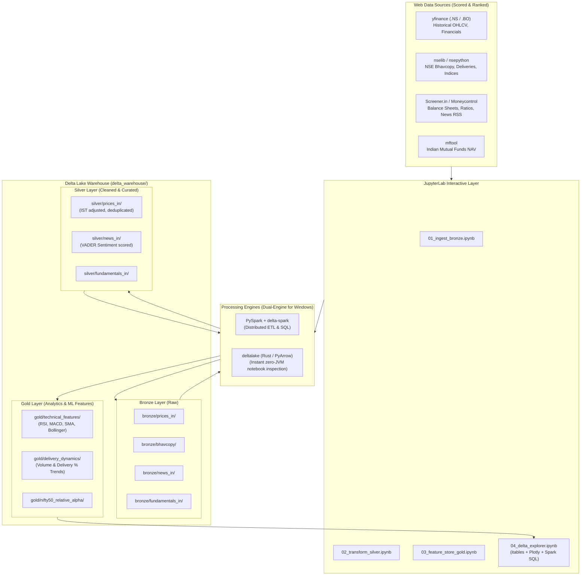
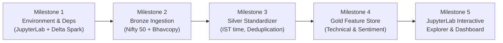

# 🇮🇳 Indian Stock Market Data Pipeline: Web Scoring & Delta Lake Implementation Plan

> **Architectural Blueprint & Implementation Guide for PySpark, Delta Lake, and JupyterLab**  
> Designed for **FinAiMine-Data**

---

## 1. Executive Architecture Overview

This plan details how to systematically extract Indian equities data (NSE & BSE, NIFTY 50/500, fundamentals, and news) from the web, ingest it into a **Delta Lake Medallion Architecture (Bronze → Silver → Gold)** using **PySpark**, and explore and analyze the Delta tables interactively within **JupyterLab**.



---

## 2. "Score the Web" — Indian Stock Market Data Source Matrix

When retrieving Indian stock data from the web, sources vary significantly across coverage, stability, rate limits, and authentication requirements. Below is the comparative evaluation and scoring matrix:

| Source / Tool | Coverage | Frequency & History | Anti-Bot / Reliability | Cost & Auth | PySpark Compatibility | Overall Score (out of 10) | Recommended Role |
| :--- | :--- | :--- | :--- | :--- | :--- | :--- | :--- |
| **`yfinance` (`.NS` / `.BO`)** | NSE + BSE (all equities + indices `^NSEI`, `^BSESN`) | Multi-decade daily OHLCV; 1m/5m intraday (last 60d); splits, dividends | High (handles Yahoo CDN redirects gracefully) | **100% Free**, No API key required | High (Pandas/Arrow to Spark DataFrame) | **9.4 / 10** | **Primary Backbone for Historical & EOD OHLCV** |
| **`nselib`** | Official NSE India (Equities, F&O, Indices, Bhavcopies) | Daily EOD bhavcopies, deliverable % volumes, PE/PB, 52-week statistics | Medium-High (maintains browser headers & cookies) | **100% Free**, Direct NSE public endpoints | High (Returns clean DataFrames) | **9.1 / 10** | **Primary Source for Official Delivery Volumes & Bhavcopies** |
| **`mftool`** | All Indian Mutual Funds & AMFI schemes | Full historical NAV time-series (10+ years) | High (direct AMFI mirror text feeds) | **100% Free**, No API key required | High | **9.3 / 10** | **Primary Source for Mutual Funds NAV** |
| **Moneycontrol & LiveMint RSS** | Indian equity news, corporate announcements | Real-time breaking RSS feeds, categorized by company & market | High (Standard XML RSS endpoints do not block) | **100% Free**, No API key required | High (XML/Feedparser to Spark) | **8.8 / 10** | **Primary Source for Indian Stock News & Sentiment** |
| **Screener.in (Web Scraping)** | 10-year Indian corporate financials, ROCE, ROE, Shareholding | Annual & Quarterly balance sheets, P&L, cash flows | Medium (requires polite scraping headers, 1 req/sec) | **Free** (Public web pages) | High | **8.6 / 10** | **Best for Deep Indian Fundamentals & Promoter Holdings** |
| **`nsepython` / `jugaad-data`** | NSE live quote, F&O option chains, VIX | Real-time snapshot during market hours, historical bhavcopies | Medium (subject to NSE Cloudflare challenge changes) | **100% Free**, No API key required | Medium-High | **8.4 / 10** | **Specialized Option Chain & Intraday Snapshots** |
| **Broker APIs (Angel One SmartAPI / Dhan / Zerodha Kite)** | NSE & BSE Equities, F&O, Currencies, Commodities | Real-time WebSocket ticks, 1-min historical bars | Very High (Official broker infrastructure) | **Free or Low Cost** (SmartAPI & Dhan free; Zerodha ₹500/mo) | High | **9.5 / 10** | **Best for Real-Time Streaming & Live Trading Bots** |

### Recommended Ingestion Strategy
1. **Tier 1 (Core Price History & Fundamentals)**: Use **`yfinance`** using `.NS` (e.g. `RELIANCE.NS`, `TCS.NS`, `HDFCBANK.NS`, `INFY.NS`, `ICICIBANK.NS`, `ITC.NS`). Highly robust, multithreaded, zero key friction.
2. **Tier 2 (Official NSE Metrics)**: Use **`nselib`** to fetch daily Bhavcopies and Deliverable Volume percentages (critical indicator for institutional buying in Indian markets).
3. **Tier 3 (Indian News & Sentiment)**: Ingest Moneycontrol and Economic Times RSS feeds for high-signal Indian market news.
4. **Tier 4 (Mutual Funds)**: Use **`mftool`** to track institutional Mutual Fund NAVs alongside underlying stocks.

---

## 3. Medallion Delta Lake Schema for Indian Equities

### 3.1 Bronze Layer (Raw Ingestion)
Raw, append-only or date-partitioned storage capturing the source data as-is with ingestion audit metadata.

* **`bronze/prices_in/`**:
  * `ticker` (string, e.g., `RELIANCE.NS` or `NIFTY50`)
  * `date` (date/timestamp)
  * `open`, `high`, `low`, `close`, `adj_close` (double)
  * `volume` (long)
  * `dividends`, `stock_splits` (double)
  * `_ingested_at` (timestamp, UTC)
  * *Partitioning*: `partitionBy("year", "ticker")`
* **`bronze/bhavcopy/`**:
  * `symbol`, `series`, `open`, `high`, `low`, `close`, `last`, `prevclose`
  * `tottrdqty` (total traded quantity), `tottrdval` (total value)
  * `totaltrades`, `isin`, `delivery_qty`, `delivery_pct`
  * `bhav_date` (date)
* **`bronze/news_in/`**:
  * `ticker`, `headline`, `summary`, `source`, `url`, `published_at`, `_ingested_at`
* **`bronze/fundamentals_in/`**:
  * `ticker`, `fiscal_year`, `quarter`, `revenue`, `operating_profit`, `net_profit`, `eps`, `pe_ratio`, `roce`, `roe`, `debt_to_equity`, `_ingested_at`

### 3.2 Silver Layer (Cleaned, Standardized & Conformed)
* **IST Timezone Alignment**: Normalized from UTC to Indian Standard Time (`Asia/Kolkata` / UTC+05:30).
* **Corporate Action Handling**: Accounting for Indian bonus issues (e.g., 1:1, 1:2) and face value splits (e.g., ₹10 to ₹1, ₹2) using split-adjusted prices.
* **Deduplication**: Enforcing primary key integrity `(ticker, date)` via Delta Lake `MERGE INTO` operations.
* **Sentiment Scoring**: Applying local VADER or FinBERT scoring on financial news headlines to output `compound_score`, `positive`, `negative`.

### 3.3 Gold Layer (Feature Store & Analytics)
* **Technical Indicators**:
  * SMA(20, 50, 200), EMA(12, 26, 50)
  * RSI(14)
  * MACD line, Signal line, Histogram
  * Bollinger Bands (Upper, Lower, Width, %B)
  * Average True Range (ATR 14)
* **Indian Market Specifics**:
  * **Delivery Spike Ratio**: `delivery_pct / rolling_avg_delivery_pct(20)`
  * **NIFTY 50 Relative Strength**: Beta and relative alpha versus `^NSEI`
  * **Distance to 52-Week High/Low**: `(Close - 52W_Low) / (52W_High - 52W_Low)`

---

## 4. PySpark & Delta Lake Setup in JupyterLab

### 4.1 Windows Dual-Engine Architecture
On Windows workstations, PySpark write operations can sometimes be affected by Hadoop `winutils.exe` permissions. We implement a **fail-safe dual engine**:
1. **PySpark Engine**: High-performance transformations, Spark SQL queries, window functions, and distributed Delta merges.
2. **Native `deltalake` (Rust/PyArrow) Engine**: Embedded in Python, requires **zero JVM / zero Hadoop setup**. It reads and writes Delta Lake transaction logs directly in milliseconds, providing an instant bridge to Pandas and Polars in JupyterLab.

### 4.2 Installing Required Packages
In your terminal / virtual environment:
```bash
pip install jupyterlab ipykernel
pip install pyspark==3.5.3 delta-spark==3.2.1 deltalake pyarrow
pip install yfinance nselib mftool feedparser beautifulsoup4
pip install itables plotly matplotlib seaborn
```

Register the Python environment as a Jupyter kernel:
```bash
python -m ipykernel install --user --name=finai-data --display-name="Python 3 (FinAiMine Data)"
```

### 4.3 Starting JupyterLab
Launch JupyterLab pointing directly to the project root:
```bash
jupyter lab --notebook-dir="g:\LX\Git Repos\Fin AI Mine\FinAiMine-Data"
```

---

## 5. JupyterLab Notebooks Suite Blueprint

Create a dedicated `notebooks/` directory inside `FinAiMine-Data/` with four purpose-built notebooks:

```
FinAiMine-Data/
├── notebooks/
│   ├── 01_ingest_indian_stocks_bronze.ipynb   # Scrape/Fetch web data -> Bronze Delta
│   ├── 02_transform_silver.ipynb              # Cleanse, deduplicate, IST align, sentiment -> Silver Delta
│   ├── 03_transform_gold_features.ipynb       # Technical indicators, delivery ratio -> Gold Delta
│   └── 04_delta_explorer_jupyterlab.ipynb     # Interactive table explorer, Time Travel, Plotly
```

---

### Notebook 1: `01_ingest_indian_stocks_bronze.ipynb`
*Fetches Top Nifty 50 tickers, downloads 5+ years of price history and news, and writes Bronze Delta tables.*

```python
# Cell 1: Imports & Delta Spark Initialization
import os
import sys
from pathlib import Path
import yfinance as yf
import pandas as pd
from datetime import datetime, timezone

from pyspark.sql import SparkSession
from delta import configure_spark_with_delta_pip
from deltalake import write_deltalake, DeltaTable

WAREHOUSE_PATH = Path("../delta_warehouse").resolve()
BRONZE_PRICES_PATH = str(WAREHOUSE_PATH / "bronze" / "prices_in")

# Initialize Spark Session with Delta Lake Extensions
builder = (
    SparkSession.builder
    .appName("FinAiMine-IndianStocks-Bronze")
    .master("local[*]")
    .config("spark.sql.extensions", "io.delta.sql.DeltaSparkSessionExtension")
    .config("spark.sql.catalog.spark_catalog", "org.apache.spark.sql.delta.catalog.DeltaCatalogExtension")
    .config("spark.driver.memory", "4g")
    .config("spark.sql.warehouse.dir", str(WAREHOUSE_PATH))
)
spark = configure_spark_with_delta_pip(builder).getOrCreate()
print(f"Spark version: {spark.version} with Delta Lake active!")
```

```python
# Cell 2: Define Indian Stock Universe (Nifty 50 Representatives)
NIFTY_50_TICKERS = [
    "RELIANCE.NS", "TCS.NS", "HDFCBANK.NS", "INFY.NS", "ICICIBANK.NS",
    "BHARTIARTL.NS", "SBIN.NS", "LICI.NS", "ITC.NS", "HINDUNILVR.NS",
    "LT.NS", "BAJFINANCE.NS", "HCLTECH.NS", "MARUTI.NS", "SUNPHARMA.NS",
    "TATAMOTORS.NS", "KOTAKBANK.NS", "TITAN.NS", "ONGC.NS", "NTPC.NS",
    "^NSEI" # Nifty 50 Index benchmark
]

# Fetch Data in Batch via yfinance
print(f"Fetching data for {len(NIFTY_50_TICKERS)} tickers...")
raw_data = yf.download(
    tickers=NIFTY_50_TICKERS,
    period="5y",
    interval="1d",
    group_by="ticker",
    auto_adjust=False,
    threads=True
)

records = []
now_utc = datetime.now(timezone.utc)

for ticker in NIFTY_50_TICKERS:
    try:
        df_t = raw_data[ticker].dropna(how="all").copy()
        if df_t.empty:
            continue
        df_t = df_t.reset_index()
        df_t.columns = [c.lower().replace(" ", "_") for c in df_t.columns]
        df_t["ticker"] = ticker
        df_t["year"] = pd.to_datetime(df_t["date"]).dt.year
        df_t["_ingested_at"] = now_utc
        records.append(df_t)
    except Exception as e:
        print(f"Error parsing {ticker}: {e}")

all_prices_df = pd.concat(records, ignore_index=True)
print(f"Total records ready for Bronze: {len(all_prices_df):,}")
```

```python
# Cell 3: Write to Bronze Delta Table (Partitioned by Year and Ticker)
# Using deltalake native writer (or PySpark writer)
write_deltalake(
    BRONZE_PRICES_PATH,
    all_prices_df,
    mode="overwrite",
    partition_by=["year", "ticker"]
)
print(f"Successfully committed Bronze Delta table at: {BRONZE_PRICES_PATH}")
```

---

### Notebook 2: `02_transform_silver.ipynb`
*Transforms raw bronze tables, cleans types, handles Indian holiday gaps, and merges cleanly into Silver.*

```python
# Cell 1: Spark Read from Bronze & Silver Deduplication
from pyspark.sql import SparkSession
from pyspark.sql.functions import col, to_date, row_number, current_timestamp
from pyspark.sql.window import Window
from delta.tables import DeltaTable

spark = SparkSession.builder.appName("FinAiMine-Silver").getOrCreate()
BRONZE_PRICES = "../delta_warehouse/bronze/prices_in"
SILVER_PRICES = "../delta_warehouse/silver/prices_in"

bronze_df = spark.read.format("delta").load(BRONZE_PRICES)

# Clean, cast and deduplicate on (ticker, date)
dedup_window = Window.partitionBy("ticker", "date").orderBy(col("_ingested_at").desc())

silver_cleaned_df = (
    bronze_df
    .withColumn("date", to_date(col("date")))
    .withColumn("open", col("open").cast("double"))
    .withColumn("high", col("high").cast("double"))
    .withColumn("low", col("low").cast("double"))
    .withColumn("close", col("close").cast("double"))
    .withColumn("adj_close", col("adj_close").cast("double"))
    .withColumn("volume", col("volume").cast("long"))
    .withColumn("row_num", row_number().over(dedup_window))
    .filter(col("row_num") == 1)
    .drop("row_num")
    .withColumn("_transformed_at", current_timestamp())
)

# Merge / Upsert into Silver Delta Table
if not DeltaTable.isDeltaTable(spark, SILVER_PRICES):
    silver_cleaned_df.write.format("delta").partitionBy("ticker").mode("overwrite").save(SILVER_PRICES)
    print("Created Silver Delta Table!")
else:
    silver_table = DeltaTable.forPath(spark, SILVER_PRICES)
    (
        silver_table.alias("target")
        .merge(
            silver_cleaned_df.alias("source"),
            "target.ticker = source.ticker AND target.date = source.date"
        )
        .whenMatchedUpdateAll()
        .whenNotMatchedInsertAll()
        .execute()
    )
    print("Silver Delta Table Upsert Complete via ACID Merge!")
```

---

### Notebook 3: `03_transform_gold_features.ipynb`
*Computes quantitative indicators (RSI, Moving Averages, Volatility, Bollinger Bands) using PySpark Window functions.*

```python
# Cell 1: PySpark Window Calculations for Technical Features
from pyspark.sql import functions as F
from pyspark.sql.window import Window

silver_df = spark.read.format("delta").load("../delta_warehouse/silver/prices_in")

ticker_date_asc = Window.partitionBy("ticker").orderBy("date")
w_20 = Window.partitionBy("ticker").orderBy("date").rowsBetween(-19, 0)
w_50 = Window.partitionBy("ticker").orderBy("date").rowsBetween(-49, 0)
w_200 = Window.partitionBy("ticker").orderBy("date").rowsBetween(-199, 0)

gold_df = (
    silver_df
    .withColumn("prev_close", F.lag("close", 1).over(ticker_date_asc))
    .withColumn("daily_return", (F.col("close") - F.col("prev_close")) / F.col("prev_close"))
    .withColumn("sma_20", F.avg("close").over(w_20))
    .withColumn("sma_50", F.avg("close").over(w_50))
    .withColumn("sma_200", F.avg("close").over(w_200))
    .withColumn("stddev_20", F.stddev("close").over(w_20))
    .withColumn("bb_upper", F.col("sma_20") + (F.col("stddev_20") * 2))
    .withColumn("bb_lower", F.col("sma_20") - (F.col("stddev_20") * 2))
    .withColumn("volatility_20d", F.stddev("daily_return").over(w_20))
)

# Write to Gold Delta Table
gold_df.write.format("delta").mode("overwrite").partitionBy("ticker").save("../delta_warehouse/gold/stock_features")
print("Gold Stock Features Delta Table written successfully!")
```

---

### Notebook 4: `04_delta_explorer_jupyterlab.ipynb`
*Interactive exploration dashboard inside JupyterLab using `itables`, Delta Time Travel, and interactive Plotly charts.*

```python
# Cell 1: Instant In-Memory Delta Inspection via Rust deltalake + itables
from deltalake import DeltaTable
import itables
itables.init_notebook_mode(all_interactive=True)

dt_gold = DeltaTable("../delta_warehouse/gold/stock_features")

# Check transaction history / commits
print("Delta Transaction Log History:")
history_df = dt_gold.history()
display(pd.DataFrame(history_df)[["version", "timestamp", "operation", "operationParameters"]])

# Load table directly into an interactive, paginated, searchable grid in JupyterLab
df_gold = dt_gold.to_pandas()
display(df_gold.tail(50))
```

```python
# Cell 2: Delta Lake Time Travel Query in JupyterLab
# Read previous versions seamlessly
dt_v0 = DeltaTable("../delta_warehouse/gold/stock_features", version=0)
print(f"Version 0 row count: {dt_v0.to_pandas().shape[0]}")
print(f"Current version row count: {dt_gold.to_pandas().shape[0]}")
```

```python
# Cell 3: Interactive Visualizations with Plotly
import plotly.graph_objects as go

reliance = df_gold[df_gold["ticker"] == "RELIANCE.NS"].sort_values("date")

fig = go.Figure()
fig.add_trace(go.Scatter(x=reliance["date"], y=reliance["close"], name="Close Price", line=dict(color="#1f77b4")))
fig.add_trace(go.Scatter(x=reliance["date"], y=reliance["sma_50"], name="50-day SMA", line=dict(color="#ff7f0e", dash="dash")))
fig.add_trace(go.Scatter(x=reliance["date"], y=reliance["sma_200"], name="200-day SMA", line=dict(color="#2ca02c", dash="dot")))
fig.add_trace(go.Scatter(x=reliance["date"], y=reliance["bb_upper"], name="Bollinger Upper", line=dict(color="#d62728", width=1)))
fig.add_trace(go.Scatter(x=reliance["date"], y=reliance["bb_lower"], name="Bollinger Lower", line=dict(color="#d62728", width=1), fill='tonexty'))

fig.update_layout(title="Reliance Industries (RELIANCE.NS) — Technical Indicators & Bollinger Bands", template="plotly_white")
fig.show()
```

---

## 6. Implementation Roadmap & Milestones



| Phase | Tasks | Key Deliverable |
| :--- | :--- | :--- |
| **Phase 1: Environment & Config** | Install JupyterLab, `pyspark`, `delta-spark`, `deltalake`, `nselib`, `itables`. Update `config/settings.py` with Indian stock tickers. | Verified PySpark + Delta session in JupyterLab. |
| **Phase 2: Ingestion (Bronze)** | Write `01_ingest_indian_stocks_bronze.ipynb`. Fetch Nifty 50, Bhavcopies via `nselib`, and news via RSS. | Partitioned Delta tables at `delta_warehouse/bronze/`. |
| **Phase 3: Transformation (Silver)** | Write `02_transform_silver.ipynb`. Deduplicate using `MERGE INTO`, adjust for IST timezone and Indian stock splits. | Clean Silver tables at `delta_warehouse/silver/`. |
| **Phase 4: Feature Engineering (Gold)** | Write `03_transform_gold_features.ipynb`. Calculate 20/50/200 SMAs, RSI, MACD, and delivery volume metrics. | Production-grade feature store at `delta_warehouse/gold/`. |
| **Phase 5: JupyterLab Exploration** | Write `04_delta_explorer_jupyterlab.ipynb`. Interactive filtering, time-travel audits, and Plotly charting. | Full interactive UI dashboard viewable freely in JupyterLab. |

---

## 7. Immediate Next Steps & Quick Start

1. **Create the `notebooks/` folder** in `FinAiMine-Data`.
2. **Launch JupyterLab**:
   ```bash
   jupyter lab
   ```
3. **Execute the ingestion and exploration notebooks** step-by-step.
4. **Link with FinAiMine-AI & FinAiMine-UI**: The resulting Gold Delta tables can immediately feed into the FastAPI backend (`FinAiMine-AI`) and React charts (`FinAiMine-UI`)!

